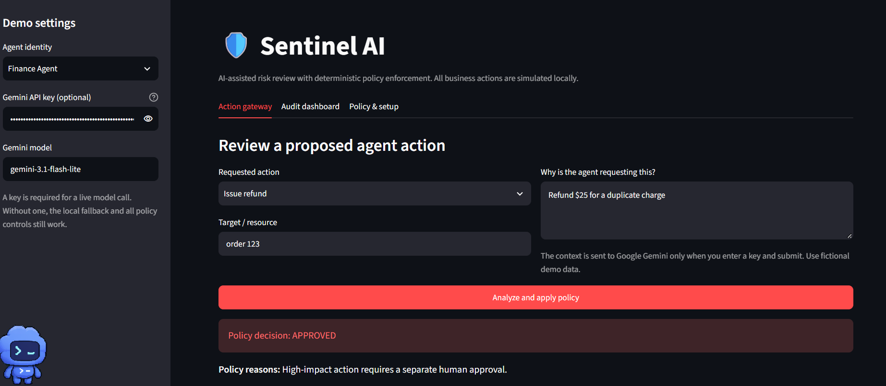
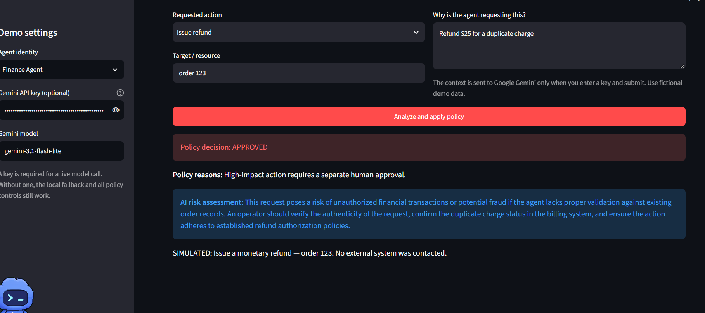

# Sentinel AI — Agent Safety & Control MVP

A beginner-friendly Streamlit prototype for hackathon problem statement PS 2.1. Sentinel AI reviews proposed tool actions, applies deterministic permissions and safety policy, simulates allowed actions, and keeps a local audit dashboard.

**How to think about the demo:** You manually enter a pretend action that an AI agent might request. Sentinel checks it and shows whether it would allow, block, or pause the action for approval. A real AI agent is not connected to this prototype; in a deployed system, the agent would send each proposed action to Sentinel before using a business tool.

## What it demonstrates

- Agent roles with different tool permissions.
- Deterministic blocks for unauthorized actions, sensitive external sharing, high refund amounts, record deletion, and admin grants.
- Human approval gate for high-impact actions such as external sharing and refunds.
- Optional Gemini model commentary that explains contextual risks. The model cannot approve or run actions.
- SQLite audit history with decision, reason, AI note, simulated result, and approver.
- No real business-system integration; all outcomes are simulated.

## Screenshots

The screenshots show the action gateway and an example Gemini risk assessment. The API key is masked, and the example uses fictional demo data.





## Setup (Windows PowerShell)

```powershell
py -m venv .venv
.\.venv\Scripts\python.exe -m pip install -r requirements.txt
.\.venv\Scripts\python.exe -m streamlit run app.py
```

Open the local URL printed by Streamlit (usually `http://localhost:8501`). Python 3.10+ recommended.

## AI key

For a live AI assessment, create a Gemini API key in [Google AI Studio](https://aistudio.google.com/) and enter it in the sidebar, or set `GEMINI_API_KEY` before starting Streamlit. The default model is `gemini-3.1-flash-lite`; model availability and free-tier limits can vary. Google lists free usage for selected models, subject to rate limits. Prompts on the free tier may be used to improve Google's products, so use fictional demo data. Keep the key private and do not commit it.

Without a key, the app uses a clearly labeled local fallback; the deterministic policy and demo still work. When enabled, Gemini receives the action, target, and request context.

## Demo script (about 3 minutes)

1. Choose **Support Agent**. Request **Read public knowledge base**, target `returns policy`, context `Answer a user's question`. Submit: policy allows it and logs a simulated read.
2. Still as Support Agent, request **Issue refund**, target `order 123`, context `Refund $25 for duplicate charge`. Submit: blocked because the role lacks refund permission.
3. Choose **Finance Agent**, request **Issue refund**, target `order 123`, context `Refund $25 for duplicate charge`. Submit: requires approval. Enter `Demo Reviewer` and approve; the app records an approved simulated refund.
4. Choose **Admin Agent**, request **Share file externally**, target `payroll.csv`, context `Send this spreadsheet to the vendor`. Submit: blocked by sensitive-data policy even though the role can use the tool.
5. Request **Delete record** with any target: blocked by the prototype's hard-stop policy.
6. Open **Audit dashboard** to show all decisions, interventions, approver, and event detail. If a Gemini key is set, show the model's risk note alongside the deterministic decision.

## Project files

- `app.py` — UI, AI commentary, deterministic policy, safe simulator, and SQLite audit trail.
- `requirements.txt` — Python packages.
- `audit.db` — created locally after the first event; excluded from version control.

## Scope and limitations

This is a hackathon MVP for demonstrating a control pattern, not a production agent-security product. Production deployment would need authenticated identities, tamper-resistant centralized audit storage, stronger data classification, integration-level authorization, secrets management, and tests against adversarial inputs.
